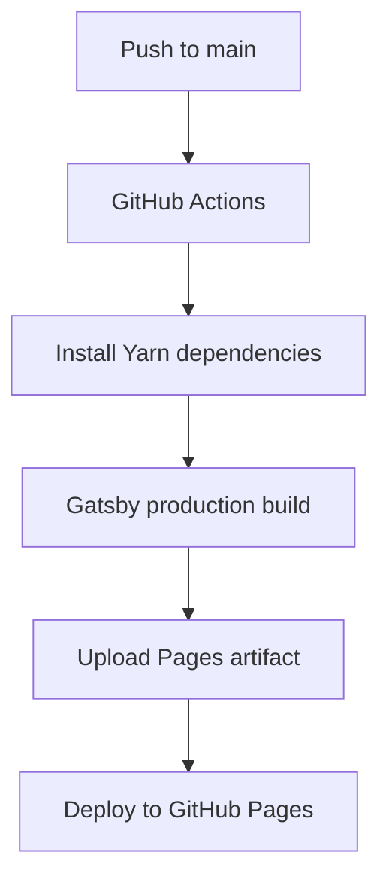

# Architecture

## Current application

The repository contains a Gatsby 3 static site using React 17 and styled-components.

- Markdown in `content/jobs`, `content/featured` and `content/projects` supplies portfolio content.
- Gatsby source-filesystem and transformer-remark plugins ingest Markdown and images.
- React components in `src/components` render navigation, hero, experience, featured work, project archive and contact sections.
- `src/config.js` centralizes navigation, social links and theme configuration.
- Gatsby builds static output into `public/`.

## Deployment flow

The GitHub Pages project path is configured as `/v13_dot_one` in Gatsby.

## Application case-study diagrams

Project-specific architecture explorers are pending source inspection of each application repository. No illustrative pipeline is presented as a verified implementation at this stage.
