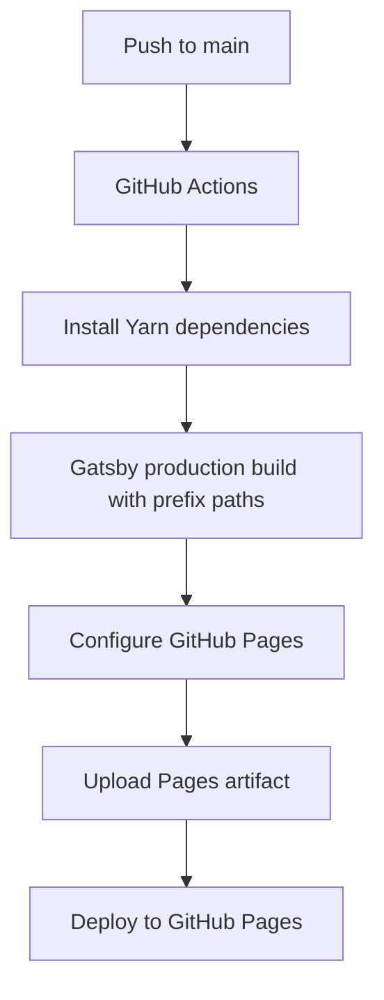

# Architecture

## Portfolio application

The site remains on Gatsby 3 and React 17 with styled-components. It uses Gatsby filesystem and Markdown transformers to ingest career, project, and case-study content. The active portfolio home is a focused editorial React page with a data-driven six-project list, category filter state, archive, activity snapshot, printable résumé, and mailto contact flow.

## Case-study routing

Markdown case studies live under `content/case-studies/`. Gatsby's `createPages` API creates a route for each Markdown entry using `src/templates/case-study.js`. The shared template renders the case-study narrative, repository/demo links, stack metadata, and an interactive architecture explorer whose selected stage is controlled by React state.

## Portfolio deployment

The project path is `/v13_dot_one`; Gatsby's `pathPrefix` and site metadata use the independent repository URL.

## Featured application architecture

- **EvidencePilot:** PDF upload → page-aware extraction → chunking → hybrid retrieval → Gemini response → citation and claim review.
- **TrackCake:** manual/text/photo entry → Astro API → selected provider → structured nutrition validation → user review → diary persistence.
- **Maplewood:** synthetic inbox → deterministic policy checks → identity/schedule tools → MCP boundary → guarded action → structured audit result.
- **Hourly:** authenticated workspace → timestamp records → PostgreSQL → shared time calculations → dashboard/history/reports/export.
- **ClashCommand:** authenticated browser → session/role checks → validated route handlers → Drizzle → PostgreSQL; external sync is an operator-run workflow.
- **Openfolio:** React/Vite dashboard → GitHub OAuth → Cloudflare Worker API → public repository import → D1 portfolio storage → server-rendered public profile; optional R2 image storage.

These flows summarize inspected repository structures and code paths. They are not runtime traces or performance measurements.
